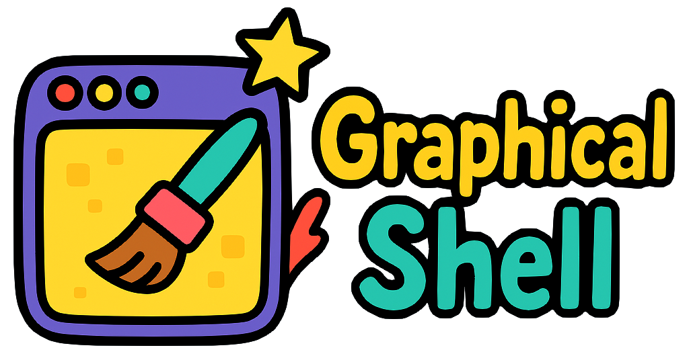
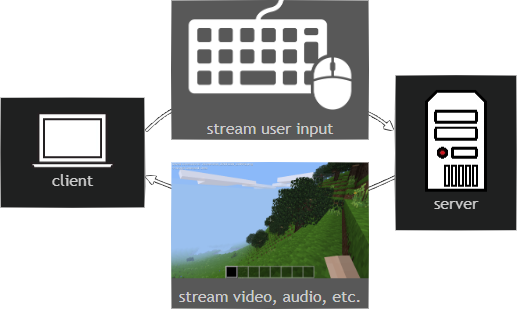

  

	
    
    
	 
    
	
	&nbsp;
	
	

 

## Graphical Shell

Graphical Shell streams server-rendered graphics to the `gsh` client and sends user input back to the server. Build services with [`libgsh`](libgsh/README.md), using TLS 1.3 with optional password or public-key authentication.

- [Install the client](client/README.md#quick-install)
- [Build a server](libgsh/README.md)
- [API reference](https://docs.rs/libgsh/latest/libgsh/)
- [Examples](examples/) · [Benchmarks](benches/) · [Community](COMMUNITY.md)

