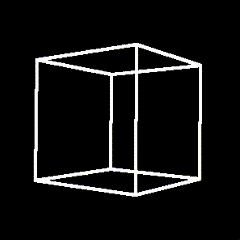

# Spinning Cube



A software-rendered cube using `vek` transformations and perspective projection. Rotation is automatic; the view adapts to window resizing.

```bash
cargo run --release -p cube
gsh localhost --insecure
```
