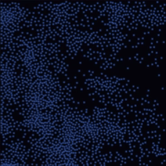

# Liquid Simulation



A CPU simulation of 2,048 particles using Rayon, with gravity, damping, wall collisions, and repulsion. Mouse movement transfers velocity to nearby particles. Frames use RGBA8 and Zstd level 3; resizing reinitializes the particles.

```bash
cargo run --release -p liquid_sim
gsh localhost --insecure
```
