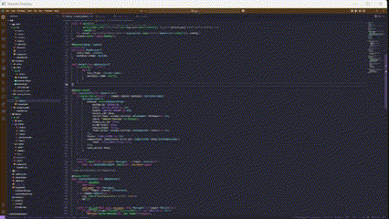

# Remote Desktop



Captures the primary monitor with `xcap` and streams RGBA frames compressed with Zstd level 3. The target rate is 60 FPS; actual performance depends on capture, compression, and network speed.

```bash
cargo run --release -p remote_desktop
gsh localhost --insecure
```
